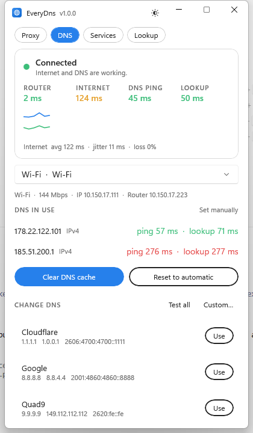

# EveryDns

A small Windows app that does two jobs: it **manages your DNS** (read it, test it, change it, clear it) and it is a **proxy client** for VLESS, VMess, Trojan and Shadowsocks servers, built on [Xray-core](https://github.com/XTLS/Xray-core).

Built with WinUI 3 (Windows App SDK) on .NET 8. The window is a small card with four tabs.



## Proxy

- Add servers by pasting `vless://`, `vmess://`, `trojan://` and `ss://` links (several at once), a subscription address, or a saved list. Transports: tcp, ws, grpc, h2, httpupgrade, xhttp. Security: none, tls, reality.
- **Subscriptions**: paste the address once; the refresh button updates them all. A failed or empty update never wipes a working list.
- **One button** connects and disconnects. Picking another server while connected moves the connection over.
- **Ping** measures the TCP connect time to every server and sorts the list fastest first. **Speed test** downloads through the connected server and reports Mbps.
- **Live numbers**: download and upload speed, delay through the proxy, and **data used** (this session and all time), counted by Xray's own stats service so only proxy traffic is included.
- **Country flags**: each server shows a round flag for the country its IP address is in.
- **Modes**: *System proxy* turns the Windows proxy on while connected (and puts your old setting back); *Local port only* just opens SOCKS `127.0.0.1:10808` and HTTP `127.0.0.1:10809` for apps you point at it yourself.
- **Routing**: *Everything* goes through the server; *Bypass Iran sites* sends `.ir` names and Iranian IP ranges direct. Local network addresses always go direct.
- **Kill switch**: while connected, Windows Firewall blocks every address except the proxy server (and your local network and DNS servers), so nothing leaks if the proxy drops. If the connection is lost the block stays until you reconnect or turn it off. Turning it off, pressing disconnect, or closing the app removes the rules. It needs administrator permission (a prompt) when it is turned on and off, and it switches *Bypass Iran sites* off, since direct routes would be blocked too.
- **Import and export**: from a file or the clipboard, to a file or the clipboard. **QR codes**: show any server as a QR code, or import QR codes straight from the screen.
- **Logs**: the proxy core's log for the current connection and the app's own log, in one window.
- **Core**: Xray-core ships inside the app. The version is shown, **Restart core** restarts it, and the core button checks the Xray-core GitHub releases and updates it (the download is checked against its published SHA-256 first). An updated core is kept in `%AppData%\EveryDns\core` and wins over the bundled one.

## DNS

- Shows every connected adapter and the DNS servers Windows is using on it, whether they are automatic or set by hand, and the ping and lookup time of each.
- **Live status**: router, internet, DNS ping and lookup time, a small latency graph, average, jitter and loss. It says plainly when the internet works but the DNS does not.
- **Clear DNS cache** with one click (no admin rights needed).
- **Change DNS** to Cloudflare, Google, Quad9, OpenDNS, AdGuard, family-safe resolvers and Iranian resolvers (Shecan, Electro, 403.online, Radar), or your own. **Test all** times every provider and marks the fastest. **Reset to automatic** hands DNS back to your router; **Undo** restores what was there before the last change.
- **DNS kill switch** (DNS guard): blocks DNS (port 53 and DNS over TLS) to every server except the ones in use, so queries cannot leak to your ISP's resolver. Changing DNS through EveryDns keeps the guard working with the new servers; resetting to automatic switches it off.
- Changing DNS asks Windows for permission (UAC) only at that moment; the app itself runs as a normal user.

## Services

Tests whether ChatGPT, Claude, Gemini, Google, YouTube, GitHub, npm, PyPI, NuGet, Docker Hub, Stack Overflow, Telegram, Instagram, X and others can be reached, one by one or all at once. When the proxy is connected the test goes through it, so you can see what the proxy unlocks. A failure says why: timed out, DNS failed, reset, or TLS failed.

## Lookup

Ask Windows, or one specific DNS server, for A, AAAA, CNAME, MX, NS and TXT records, with the answer time.

## Privacy

- Server IP addresses are sent to [ipwho.is](https://ipwho.is) to find their country, and flag images come from [flagcdn.com](https://flagcdn.com). Each answer is saved on disk and asked only once.
- Update checks talk to the GitHub API. Nothing else leaves the app.
- Exported links contain your server passwords; keep the files private.

## Requirements

- Windows 10 (build 17763) or later, 64-bit.
- To build: the .NET 8 SDK and, for the installer, [Inno Setup](https://jrsoftware.org/isinfo.php).

## Build and run

```powershell
dotnet build EveryDns.csproj -c Release -p:Platform=x64
powershell -ExecutionPolicy Bypass -File build-installer.ps1
```

`build-installer.ps1` downloads Xray-core into `core\` on first run (it is not stored in git), publishes a self-contained build and compiles `installer\Output\EveryDns-Setup-<version>.exe`. The installer needs no admin rights.

Tests: `dotnet test tests\EveryDns.Tests` (link parsing, DNS packets, QR round trip, and real Xray processes when `core\` exists).

## Limits

- The kill switch and DNS guard are Windows Firewall rules added by EveryDns (they do not change any firewall default). If the internet stays blocked after a crash, open EveryDns and turn the switch off, or run as administrator: `netsh advfirewall firewall delete rule name="EveryDns Kill Switch"` (and `"EveryDns DNS Guard"` for the guard). Running EveryDns as administrator avoids the permission prompts.
- No TUN (whole-system VPN) mode yet; apps that ignore the Windows proxy need the local port set by hand.
- Hysteria and TUIC are not supported (Xray-core does not run them).
- Some networks block ping (ICMP); the DNS tab then shows "no reply" for ping while lookups still work.
- The DNS and proxy features are tested on Windows 11; changing DNS goes through `netsh`, so it follows whatever `netsh` supports on your edition of Windows.

## Author

Arman Soltani. Xray-core is by the [XTLS](https://github.com/XTLS/Xray-core) project (MPL-2.0).
